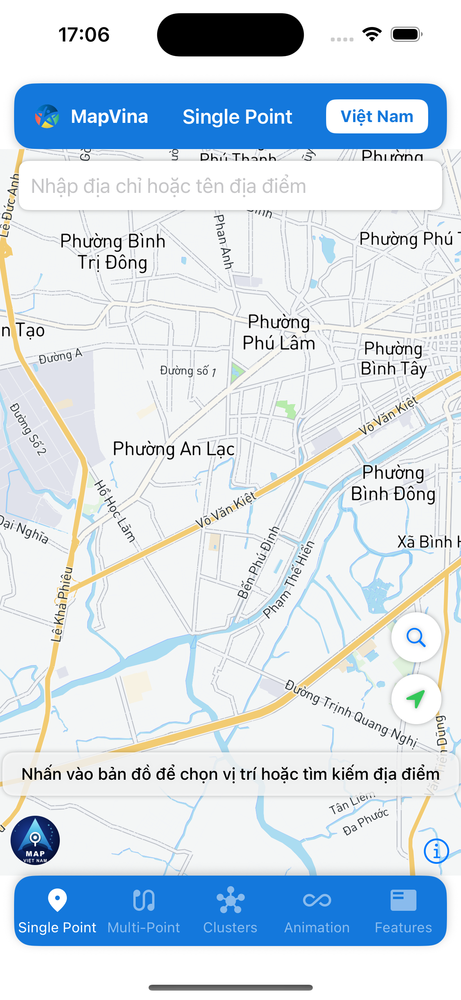

# mapvina-document-ios: verification 04/10/2026

**Status: BUILD/RUNTIME PASS; BRANDING BLOCKED.**

SPM public `1.0.0`, native release `ios-v1.0.0`; source native VERSION `1.0.1` is not a published SDK.

Source baseline: `f21add84b4338f56dfa23b3317cf4b90a12a97da` (`origin/main` plus the sample/doc changes in this PR).

Audit only: no SDK API/version changes, tags, publishing or main merge.

## Cấu hình public được kiểm chứng

Sample dùng SPM dependency exact `1.0.0` trong package navigation local;
navigation source local không đồng nghĩa native binary local. Binary native
được SPM tải từ GitHub release public. Symlink absolute trong `demo/libs/` đã
được loại bỏ; không copy XCFramework local để thay cho dependency public.

```swift
.package(url: "https://github.com/mapvina/mapvina-gl-native-distribution.git", exact: "1.0.0")
```

```bash
cd demo
unset MAPVINA_NATIVE_PACKAGE_PATH
xcodebuild -workspace MapVinaSample.xcworkspace -scheme MapVinaSample \
  -configuration Debug -sdk iphonesimulator \
  -destination 'platform=iOS Simulator,id=<YOUR_SIMULATOR_UDID>' \
  -derivedDataPath build CODE_SIGNING_ALLOWED=NO build
```

Xcode 26.4, iPhone 16 iOS 18.6: streets render sau khi cài và khởi động app.
`import MapVina`; map style URL trong demo đã kèm demo key. Cấp quyền
When In Use nếu bật hiển thị vị trí; không cần Always chỉ để render map.
Overlay trợ giúp được đẩy lên 48pt để không che logo bottom-start.

ZIP public có SHA-256
`931b726a76d7b79c241a8fac70702f9da0ec109a7ff01f01a403c50e9ff4f156`.
Assets.car trong app khớp SHA-256 với slice simulator của ZIP public:
`47e24a4015c7b45368c538f240ecdc2c827fd1c1da1f040d62c4360a0b6e6016`.
Catalog còn `mapbox`, `mapbox_helmet`, `mapvina-logo-icon`,
`mapvina-logo-stroke-gray`; không có `mapvina-logo-horizontal-primary`.
Header sample vẫn dùng biểu tượng cũ; audit này không thay asset ứng dụng.
Vì thế logo tròn “MAP VIỆT NAM” trong ảnh dưới là lỗi branding của **binary public**,
không phải bằng chứng iOS logo mới đã phát hành.

CocoaPods trunk API cho `MapVina` trả 404. Pods của demo chỉ phục vụ các dependency
khác; không hướng dẫn `pod 'MapVina'` như một SDK đã tồn tại trên CDN.
Local XCFramework từ source native có logo mới trong lần kiểm tra tháng 9;
chưa rebuild local trong audit này và không dùng kết quả cũ làm PASS mới.
Landscape, bốn ornament positions, snapshot, dark/satellite: NOT TESTED.



## Evidence and acceptance boundary

- [ios-public-final.log](evidence/ios-public-final.log)
- [ios-public-provenance.txt](evidence/ios-public-provenance.txt)

[Cross-repository artifact and runtime audit](https://github.com/mapvina/mapvina-document-android/blob/codex/docs-verification-20261004/docs/verification/2026-10-04/README.md).

PASS applies only to the named checks. BLOCKED is a reproduced failure; NOT TESTED is not a pass.

## Separate follow-up

[Reproduced blocker issue](https://github.com/mapvina/mapvina-native/issues/7). SDK/infra fixes are outside this PR.

[Verified release/tag commit identities](evidence/release-provenance.json). Tag association is not a full reproducible-build attestation.
